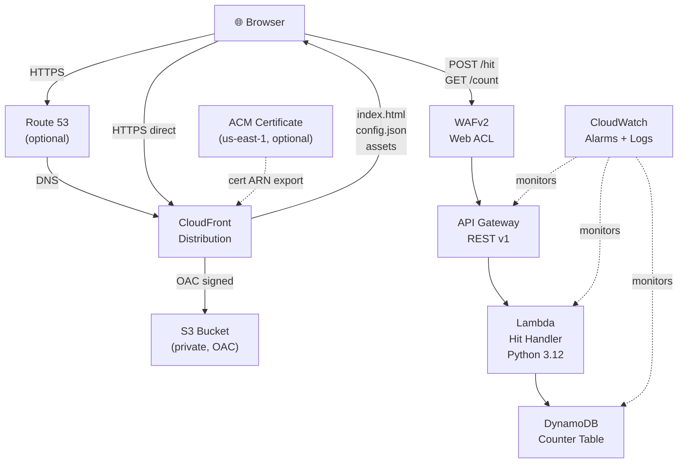

# Design Document — Website Access Counter

## Overview

This document describes the full architecture for migrating and expanding the existing HitCloud counter into a production-ready, deployable website. The system is a static "Em breve" (Coming Soon) page with a shared page-access counter backed by AWS serverless infrastructure defined entirely in CDK v2 (Python).

The scope is strictly the shared page-access counter. Email registration, SQS, SES, authentication, and subscriber management are excluded.

---

## Architecture

### High-Level Flow

```
Browser
  │
  ├─► Route 53 (optional, when domain_name context set)
  │         │
  ├─────────▼──────────────────────────────────────────────────┐
  │    CloudFront Distribution (HTTPS only)                     │
  │    ┌─────────────────────┐   ┌────────────────────────┐    │
  │    │ S3 Origin (OAC)     │   │ API Gateway Origin      │    │
  │    │ - index.html        │   │  (optional via CF path) │    │
  │    │ - styles.css        │   └────────────────────────┘    │
  │    │ - main.js           │                                  │
  │    │ - config.json       │                                  │
  │    └─────────────────────┘                                  │
  └─────────────────────────────────────────────────────────────┘
  │
  │  (API calls go directly to API Gateway, not through CloudFront)
  │
  ▼
WAFv2 Regional Web ACL
  │
  ▼
API Gateway REST API v1 (us-east-2)
  ├── POST /hit
  └── GET /count
          │
          ▼
     Lambda Hit Handler (Python 3.12)
          │
          ▼
     DynamoDB Counter Table (on-demand)
          id="hits" → count (Number)

CloudWatch monitors Lambda + API Gateway + DynamoDB
```

### Mermaid Architecture Diagram



---

## Stack Structure

### CDK App (`app.py`)

Two optional stacks synthesised from a single CDK App:

```python
app = cdk.App()

# CertStack — optional, only when domain_name + hosted_zone_id context present
if app.node.try_get_context("domain_name") and app.node.try_get_context("hosted_zone_id"):
    cert_stack = CertStack(app, "CertStack",
        env=cdk.Environment(account=aws_account, region="us-east-1"))

app_stack = AppStack(app, "AppStack",
    env=cdk.Environment(account=aws_account, region="us-east-2"),
    certificate=cert_stack.certificate if cert_stack else None)

app.synth()
```

### CDK Context Keys (`cdk.json`)

| Key | Type | Default | Description |
|-----|------|---------|-------------|
| `domain_name` | string | _(absent)_ | Custom domain (e.g. `example.com`) |
| `hosted_zone_id` | string | _(absent)_ | Route 53 hosted zone ID |
| `environment` | string | `"dev"` | Environment name (affects removal policy) |
| `aws_account` | string | _(required)_ | AWS account ID |
| `api_burst_limit` | number | `500` | API Gateway burst limit |
| `api_rate_limit` | number | `1000` | API Gateway rate limit (req/s) |
| `waf_rate_limit` | number | `1000` | WAF rate-based rule (req/5min per IP) |
| `alarm_lambda_errors_threshold` | number | `1` | Lambda Errors alarm threshold |
| `alarm_lambda_throttles_threshold` | number | `1` | Lambda Throttles alarm threshold |
| `alarm_api_5xx_threshold` | number | `5` | API 5XXError alarm threshold |
| `alarm_ddb_errors_threshold` | number | `1` | DynamoDB SystemErrors alarm threshold |
| `log_retention_days` | number | `30` | CloudWatch log retention |

---

## Component Designs

### 1. CertStack (`hitcloud/cert_stack.py`)

Deployed exclusively to `us-east-1`. Conditionally instantiated.

```python
class CertStack(Stack):
    def __init__(self, scope, id, **kwargs):
        super().__init__(scope, id, **kwargs)

        domain_name = self.node.try_get_context("domain_name")
        hosted_zone_id = self.node.try_get_context("hosted_zone_id")

        hosted_zone = route53.HostedZone.from_hosted_zone_attributes(
            self, "Zone",
            hosted_zone_id=hosted_zone_id,
            zone_name=domain_name,
        )

        self.certificate = acm.Certificate(
            self, "Certificate",
            domain_name=domain_name,
            validation=acm.CertificateValidation.from_dns(hosted_zone),
        )

        # Cross-stack export consumed by AppStack
        CfnOutput(self, "CertificateArn",
            value=self.certificate.certificate_arn,
            export_name="HitCloudCertificateArn")
```

### 2. AppStack (`hitcloud/app_stack.py`)

Primary stack in `us-east-2`. Replaces the existing `HitCloudStack`.

#### 2a. S3 Bucket

```python
bucket = s3.Bucket(self, "WebsiteBucket",
    block_public_access=s3.BlockPublicAccess.BLOCK_ALL,
    encryption=s3.BucketEncryption.S3_MANAGED,
    versioned=True,
    removal_policy=cdk.RemovalPolicy.RETAIN,  # always retain static assets
)
```

#### 2b. CloudFront OAC and Distribution

```python
oac = cloudfront.S3OriginAccessControl(self, "OAC",
    signing=cloudfront.Signing.SIGV4_ALWAYS,
)

s3_origin = origins.S3BucketOrigin.with_origin_access_control(bucket, oac)

# Security headers response policy
security_headers = cloudfront.ResponseHeadersPolicy(self, "SecurityHeaders",
    security_headers_behavior=cloudfront.ResponseSecurityHeadersBehavior(
        strict_transport_security=cloudfront.ResponseHeadersStrictTransportSecurity(
            access_control_max_age=Duration.seconds(63072000),
            include_subdomains=True, override=True,
        ),
        content_type_options=cloudfront.ResponseHeadersContentTypeOptions(override=True),
        frame_options=cloudfront.ResponseHeadersFrameOptions(
            frame_option=cloudfront.HeadersFrameOption.DENY, override=True,
        ),
        referrer_policy=cloudfront.ResponseHeadersReferrerPolicy(
            referrer_policy=cloudfront.HeadersReferrerPolicy.STRICT_ORIGIN_WHEN_CROSS_ORIGIN,
            override=True,
        ),
        content_security_policy=cloudfront.ResponseHeadersContentSecurityPolicy(
            content_security_policy=f"default-src 'self'; connect-src {api_url}; script-src 'self'; style-src 'self';",
            override=True,
        ),
    ),
)

# Cache policies
short_cache = cloudfront.CachePolicy(self, "ShortCachePolicy",
    default_ttl=Duration.seconds(60),
    max_ttl=Duration.seconds(60),
    min_ttl=Duration.seconds(0),
)

long_cache = cloudfront.CachePolicy(self, "LongCachePolicy",
    default_ttl=Duration.days(365),
    max_ttl=Duration.days(365),
    min_ttl=Duration.days(365),
)

distribution = cloudfront.Distribution(self, "Distribution",
    default_behavior=cloudfront.BehaviorOptions(
        origin=s3_origin,
        viewer_protocol_policy=cloudfront.ViewerProtocolPolicy.REDIRECT_TO_HTTPS,
        cache_policy=short_cache,
        response_headers_policy=security_headers,
    ),
    additional_behaviors={
        # Versioned assets: long cache
        "*.js": cloudfront.BehaviorOptions(origin=s3_origin,
            cache_policy=long_cache,
            response_headers_policy=security_headers,
            viewer_protocol_policy=cloudfront.ViewerProtocolPolicy.REDIRECT_TO_HTTPS),
        "*.css": cloudfront.BehaviorOptions(origin=s3_origin,
            cache_policy=long_cache,
            response_headers_policy=security_headers,
            viewer_protocol_policy=cloudfront.ViewerProtocolPolicy.REDIRECT_TO_HTTPS),
        # config.json: short cache
        "/config.json": cloudfront.BehaviorOptions(origin=s3_origin,
            cache_policy=short_cache,
            response_headers_policy=security_headers,
            viewer_protocol_policy=cloudfront.ViewerProtocolPolicy.REDIRECT_TO_HTTPS),
    },
    default_root_object="index.html",
    certificate=certificate,  # None when no custom domain
    domain_names=[domain_name] if domain_name else None,
)
```

**Note:** AWS Shield Standard is automatically included with CloudFront at no additional cost. AWS Shield Advanced is NOT provisioned by this stack.

#### 2c. DynamoDB Counter Table

```python
env = self.node.try_get_context("environment") or "dev"
is_production = env == "production"

table = dynamodb.Table(self, "CounterTable",
    partition_key=dynamodb.Attribute(name="id", type=dynamodb.AttributeType.STRING),
    billing_mode=dynamodb.BillingMode.PAY_PER_REQUEST,
    encryption=dynamodb.TableEncryption.AWS_MANAGED,
    point_in_time_recovery=True,
    deletion_protection=is_production,
    removal_policy=cdk.RemovalPolicy.RETAIN if is_production else cdk.RemovalPolicy.DESTROY,
)
```

**Counter item schema:**
```
PK: id = "hits"  (String)
Attribute: count  (Number)
```

**Note:** The counter item is NOT pre-seeded. The Lambda handler uses `if_not_exists(#count, :zero)` in the UpdateItem expression to handle first-write initialization atomically.

**Single-Partition Limitation:** The `id="hits"` key places all writes on a single DynamoDB partition, subject to the per-partition write throughput limit (~1,000 WCU/s sustained). For sustained high-throughput scenarios, a sharded counter design (multiple partition keys `hits_0` through `hits_N` with client-side aggregation) is recommended.

#### 2d. Lambda Hit Handler

```python
log_group = logs.LogGroup(self, "HitHandlerLogGroup",
    log_group_name=f"/aws/lambda/HitHandler-{env}",
    retention=logs.RetentionDays(log_retention_days),
    removal_policy=cdk.RemovalPolicy.DESTROY,
)

hit_handler = _lambda.Function(self, "HitHandler",
    runtime=_lambda.Runtime.PYTHON_3_12,
    handler="handler.handler",
    code=_lambda.Code.from_asset("lambda"),
    environment={
        "TABLE_NAME": table.table_name,
        "ALLOWED_ORIGIN": website_url,
    },
    log_group=log_group,
)

# Least-privilege IAM: only UpdateItem + GetItem on this table's ARN
table.grant(hit_handler, "dynamodb:UpdateItem", "dynamodb:GetItem")

# Logs permissions scoped to function's log group only
hit_handler.add_to_role_policy(iam.PolicyStatement(
    actions=["logs:CreateLogGroup", "logs:CreateLogStream", "logs:PutLogEvents"],
    resources=[log_group.log_group_arn, f"{log_group.log_group_arn}:*"],
))
```

#### 2e. API Gateway REST API v1

```python
api = apigw.RestApi(self, "CounterApi",
    rest_api_name=f"hitcloud-api-{env}",
    endpoint_types=[apigw.EndpointType.REGIONAL],
    deploy_options=apigw.StageOptions(
        stage_name=env,
        throttling_burst_limit=api_burst_limit,
        throttling_rate_limit=api_rate_limit,
        logging_level=apigw.MethodLoggingLevel.ERROR,
        data_trace_enabled=False,  # no PII in logs
        metrics_enabled=True,
    ),
    default_cors_preflight_options=apigw.CorsOptions(
        allow_origins=[website_url, "http://localhost:5173"],  # dev allowed in non-prod
        allow_methods=["GET", "POST", "OPTIONS"],
        allow_headers=["Content-Type"],
    ),
)

# Gateway responses with CORS headers (for WAF blocks, throttles, etc.)
for response_type in [
    apigw.ResponseType.DEFAULT_4XX,
    apigw.ResponseType.DEFAULT_5XX,
    apigw.ResponseType.THROTTLED,
    apigw.ResponseType.UNAUTHORIZED,
]:
    api.add_gateway_response(f"GatewayResponse{response_type.response_type}",
        type=response_type,
        response_headers={
            "Access-Control-Allow-Origin": f"'{website_url}'",
            "Access-Control-Allow-Headers": "'Content-Type'",
        },
    )

lambda_integration = apigw.LambdaIntegration(hit_handler, proxy=True)

hit_resource = api.root.add_resource("hit")
hit_resource.add_method("POST", lambda_integration)

count_resource = api.root.add_resource("count")
count_resource.add_method("GET", lambda_integration)

# Restrict Lambda invocation to this specific API Gateway ARN
hit_handler.add_permission("ApiGatewayInvoke",
    principal=iam.ServicePrincipal("apigateway.amazonaws.com"),
    source_arn=api.arn_for_execute_api(),
)
```

#### 2f. WAFv2 Web ACL

```python
web_acl = wafv2.CfnWebACL(self, "WebAcl",
    scope="REGIONAL",
    default_action=wafv2.CfnWebACL.DefaultActionProperty(allow={}),
    visibility_config=wafv2.CfnWebACL.VisibilityConfigProperty(
        cloud_watch_metrics_enabled=True,
        metric_name="HitCloudWebAcl",
        sampled_requests_enabled=True,
    ),
    rules=[
        # AWS Managed Rules: Common Rule Set
        wafv2.CfnWebACL.RuleProperty(
            name="AWSManagedRulesCommonRuleSet",
            priority=1,
            override_action=wafv2.CfnWebACL.OverrideActionProperty(none={}),
            statement=wafv2.CfnWebACL.StatementProperty(
                managed_rule_group_statement=wafv2.CfnWebACL.ManagedRuleGroupStatementProperty(
                    vendor_name="AWS",
                    name="AWSManagedRulesCommonRuleSet",
                ),
            ),
            visibility_config=wafv2.CfnWebACL.VisibilityConfigProperty(
                cloud_watch_metrics_enabled=True,
                metric_name="CommonRuleSet",
                sampled_requests_enabled=True,
            ),
        ),
        # Rate-based rule: per source IP
        wafv2.CfnWebACL.RuleProperty(
            name="RateLimitPerIp",
            priority=2,
            action=wafv2.CfnWebACL.RuleActionProperty(block={}),
            statement=wafv2.CfnWebACL.StatementProperty(
                rate_based_statement=wafv2.CfnWebACL.RateBasedStatementProperty(
                    limit=waf_rate_limit,
                    aggregate_key_type="IP",
                ),
            ),
            visibility_config=wafv2.CfnWebACL.VisibilityConfigProperty(
                cloud_watch_metrics_enabled=True,
                metric_name="RateLimitPerIp",
                sampled_requests_enabled=True,
            ),
        ),
    ],
)

# Associate WAF with API Gateway stage
wafv2.CfnWebACLAssociation(self, "WebAclAssociation",
    resource_arn=f"arn:aws:apigateway:{self.region}::/restapis/{api.rest_api_id}/stages/{env}",
    web_acl_arn=web_acl.attr_arn,
)
```

**WAF Notes:**
- Managed rules may produce false positives; consult WAF logs (not Lambda error metrics) for complete traffic analysis.
- WAF blocks are not reflected in Lambda error metrics — Lambda is never invoked for blocked requests.
- WAF logs should be enabled separately via `CfnLoggingConfiguration` for full audit trails.

#### 2g. CloudWatch Alarms

```python
# Lambda Errors alarm
cloudwatch.Alarm(self, "LambdaErrorsAlarm",
    metric=hit_handler.metric_errors(period=Duration.minutes(1)),
    threshold=alarm_lambda_errors_threshold,
    evaluation_periods=1,
    alarm_description="Hit Handler Lambda errors",
    comparison_operator=cloudwatch.ComparisonOperator.GREATER_THAN_OR_EQUAL_TO_THRESHOLD,
    treat_missing_data=cloudwatch.TreatMissingData.NOT_BREACHING,
)

# Lambda Throttles alarm
cloudwatch.Alarm(self, "LambdaThrottlesAlarm",
    metric=hit_handler.metric_throttles(period=Duration.minutes(1)),
    threshold=alarm_lambda_throttles_threshold,
    evaluation_periods=1,
    alarm_description="Hit Handler Lambda throttles",
    comparison_operator=cloudwatch.ComparisonOperator.GREATER_THAN_OR_EQUAL_TO_THRESHOLD,
    treat_missing_data=cloudwatch.TreatMissingData.NOT_BREACHING,
)

# API 5XXError alarm
cloudwatch.Alarm(self, "Api5xxAlarm",
    metric=api.metric_server_error(period=Duration.minutes(1)),
    threshold=alarm_api_5xx_threshold,
    evaluation_periods=1,
    alarm_description="API Gateway 5XX errors",
    comparison_operator=cloudwatch.ComparisonOperator.GREATER_THAN_OR_EQUAL_TO_THRESHOLD,
    treat_missing_data=cloudwatch.TreatMissingData.NOT_BREACHING,
)

# DynamoDB SystemErrors alarm
cloudwatch.Alarm(self, "DdbSystemErrorsAlarm",
    metric=table.metric_system_errors_for_operations(period=Duration.minutes(1)),
    threshold=alarm_ddb_errors_threshold,
    evaluation_periods=1,
    alarm_description="DynamoDB Counter Table system errors",
    comparison_operator=cloudwatch.ComparisonOperator.GREATER_THAN_OR_EQUAL_TO_THRESHOLD,
    treat_missing_data=cloudwatch.TreatMissingData.NOT_BREACHING,
)
```

**Alarm Notification Note:** Alarms transition to ALARM state but do NOT automatically send notifications. To receive alerts, attach an SNS topic action:
```python
from aws_cdk.aws_cloudwatch_actions import SnsAction
alarm.add_alarm_action(SnsAction(sns_topic))
```

#### 2h. CloudFormation Outputs

```python
CfnOutput(self, "WebsiteUrl", value=f"https://{domain_name or distribution.domain_name}")
CfnOutput(self, "ApiUrl", value=api.url)
CfnOutput(self, "DistributionId", value=distribution.distribution_id)
CfnOutput(self, "TableName", value=table.table_name)
```

---

### 3. Lambda Hit Handler (`lambda/handler.py`)

The handler is a complete rewrite of the existing single-purpose increment function. It now handles two routes and two HTTP methods.

```python
import json
import os
import boto3
from botocore.config import Config
from botocore.exceptions import ClientError

# Module-level DynamoDB resource (for GET /count — retries are acceptable for reads)
dynamodb = boto3.resource("dynamodb")
TABLE_NAME = os.environ["TABLE_NAME"]
ALLOWED_ORIGIN = os.environ.get("ALLOWED_ORIGIN", "*")


def _cors_headers() -> dict:
    return {
        "Content-Type": "application/json",
        "Access-Control-Allow-Origin": ALLOWED_ORIGIN,
        "Access-Control-Allow-Methods": "GET, POST, OPTIONS",
        "Access-Control-Allow-Headers": "Content-Type",
        "Cache-Control": "no-store",
    }


def _response(status_code: int, body: dict) -> dict:
    return {
        "statusCode": status_code,
        "headers": _cors_headers(),
        "body": json.dumps(body),
    }


def _handle_post_hit() -> dict:
    """POST /hit — atomic increment, no retries to prevent double-count."""
    # Separate client with total_max_attempts=1 to prevent double-increments
    ddb_client = boto3.client("dynamodb", config=Config(
        retries={"total_max_attempts": 1, "mode": "standard"}
    ))
    try:
        result = ddb_client.update_item(
            TableName=TABLE_NAME,
            Key={"id": {"S": "hits"}},
            UpdateExpression="SET #count = if_not_exists(#count, :zero) + :one",
            ExpressionAttributeNames={"#count": "count"},
            ExpressionAttributeValues={":zero": {"N": "0"}, ":one": {"N": "1"}},
            ReturnValues="ALL_NEW",
        )
        count = int(result["Attributes"]["count"]["N"])
        print(json.dumps({"status": "ok", "method": "POST /hit", "count": count}))
        return _response(200, {"count": count})
    except ClientError as exc:
        code = exc.response["Error"]["Code"]
        if code in ("ProvisionedThroughputExceededException", "RequestLimitExceeded",
                    "ServiceUnavailable", "ThrottlingException", "InternalServerError"):
            print(json.dumps({"status": "error", "error_code": code}))
            return _response(503, {"error": "Service temporarily unavailable"})
        print(json.dumps({"status": "error", "error_code": code}))
        return _response(503, {"error": "Service temporarily unavailable"})
    except Exception as exc:
        print(json.dumps({"status": "error", "error_type": type(exc).__name__}))
        return _response(503, {"error": "Service temporarily unavailable"})


def _handle_get_count() -> dict:
    """GET /count — strongly consistent read, never modifies counter."""
    table = dynamodb.Table(TABLE_NAME)
    try:
        result = table.get_item(
            Key={"id": "hits"},
            ConsistentRead=True,
        )
        item = result.get("Item")
        count = int(item["count"]) if item and "count" in item else 0
        print(json.dumps({"status": "ok", "method": "GET /count", "count": count}))
        return _response(200, {"count": count})
    except ClientError as exc:
        code = exc.response["Error"]["Code"]
        print(json.dumps({"status": "error", "error_code": code}))
        return _response(503, {"error": "Service temporarily unavailable"})
    except Exception as exc:
        print(json.dumps({"status": "error", "error_type": type(exc).__name__}))
        return _response(503, {"error": "Service temporarily unavailable"})


def handler(event, context):
    method = event.get("httpMethod", "")
    path = event.get("path", "")

    if method == "OPTIONS":
        print(json.dumps({"status": "ok", "method": "OPTIONS"}))
        return _response(200, {})

    if method == "POST" and path == "/hit":
        return _handle_post_hit()

    if method == "GET" and path == "/count":
        return _handle_get_count()

    print(json.dumps({"status": "error", "error": "method_not_allowed",
                      "method": method, "path": path}))
    return _response(405, {"error": "Method not allowed"})
```

**Key design decisions:**
- `POST /hit` uses a dedicated `boto3.client` with `total_max_attempts=1` to avoid retry-induced double-increments on the non-idempotent `UpdateItem`.
- `GET /count` uses the module-level `boto3.resource` (retries acceptable for reads).
- `if_not_exists(#count, :zero)` handles first-write initialization — no CDK custom resource seed needed.
- CORS origin is injected at deploy time via `ALLOWED_ORIGIN` env var, not hard-coded.
- `Cache-Control: no-store` prevents browser/proxy caching of counter values.
- Log entries contain `status` only; no request bodies, HTTP headers, or PII.

---

### 4. Frontend (`frontend/`)

#### Directory Structure

```
frontend/
├── src/
│   ├── main.ts          # Application entry point
│   ├── api.ts           # API client (fetch wrapper)
│   └── types.ts         # Shared TypeScript interfaces
├── public/
│   ├── index.html       # HTML shell (copied to dist)
│   └── styles.css       # CSS with reduced-motion support
├── tests/
│   ├── main.test.ts     # Jest/Vitest unit tests
│   └── setup.ts         # jsdom setup
├── tsconfig.json
├── vite.config.ts       # or webpack.config.js
└── package.json
```

`frontend/dist/` is the compiled output directory. It is listed in `.gitignore` and NOT committed to source control.

#### `config.json` (generated at deploy time)

```json
{
  "apiUrl": "https://abc123.execute-api.us-east-2.amazonaws.com/prod"
}
```

Generated by the CDK deploy script and uploaded to the S3 bucket alongside other static assets.

#### `index.html` Structure

```html
<!DOCTYPE html>
<html lang="pt-BR">
<head>
  <meta charset="UTF-8" />
  <meta name="viewport" content="width=device-width, initial-scale=1.0" />
  <title>Em breve</title>
  <link rel="stylesheet" href="styles.css" />
</head>
<body>
  <main>
    <h1>Em breve</h1>
    <p class="intro">Uma nova experiência está chegando.</p>

    <section class="counter-card" aria-labelledby="counter-label">
      <span id="counter-label">Total de acessos</span>
      <span id="counter-display"
            aria-live="polite"
            aria-atomic="true">–</span>
    </section>

    <button id="refresh-btn" type="button">Atualizar contagem</button>

    <div id="status-message"
         role="status"
         aria-live="assertive"
         aria-atomic="true"></div>
  </main>

  <footer>
    <p>© 2024 HitCloud</p>
  </footer>

  <script type="module" src="main.js"></script>
</body>
</html>
```

#### `main.ts` Logic

```typescript
interface Config { apiUrl: string; }
interface CountResponse { count: number; }

// OAD (Offline/Mock) Mode: enabled via build flag or ?oad=1 URL param
const IS_OAD = import.meta.env.VITE_OAD_MODE === "true" ||
               new URLSearchParams(window.location.search).has("oad");

async function loadConfig(): Promise<Config> {
  if (IS_OAD) return { apiUrl: "mock://local" };
  const res = await fetch("/config.json");
  return res.json();
}

async function mockFetch(url: string, method: string): Promise<CountResponse> {
  // Simulated responses for OAD mode
  return { count: 42 };
}

function formatCount(n: number): string {
  return new Intl.NumberFormat("pt-BR").format(n);
}

function setLoading(isLoading: boolean): void {
  const display = document.getElementById("counter-display")!;
  const btn = document.getElementById("refresh-btn") as HTMLButtonElement;
  const status = document.getElementById("status-message")!;
  if (isLoading) {
    display.textContent = "Carregando...";
    btn.disabled = true;
    status.textContent = "";
  } else {
    btn.disabled = false;
  }
}

function setCount(count: number): void {
  document.getElementById("counter-display")!.textContent = formatCount(count);
  document.getElementById("status-message")!.textContent = "";
}

function setError(message: string): void {
  document.getElementById("counter-display")!.textContent = "–";
  document.getElementById("status-message")!.textContent = message;
}

let hitSent = false;  // guard: exactly one POST /hit per page load

async function sendHit(config: Config): Promise<void> {
  if (hitSent) return;
  hitSent = true;
  setLoading(true);
  try {
    const data = IS_OAD
      ? await mockFetch(config.apiUrl, "POST")
      : await fetch(`${config.apiUrl}/hit`, {
          method: "POST",
          headers: { "Content-Type": "application/json" },
          signal: AbortSignal.timeout(5000),
        }).then(r => r.json() as Promise<CountResponse>);
    setCount(data.count);
  } catch {
    setError("Não foi possível registrar o acesso. Tente novamente mais tarde.");
  } finally {
    setLoading(false);
  }
}

async function refreshCount(config: Config): Promise<void> {
  setLoading(true);
  try {
    const data = IS_OAD
      ? await mockFetch(config.apiUrl, "GET")
      : await fetch(`${config.apiUrl}/count`).then(r => r.json() as Promise<CountResponse>);
    setCount(data.count);
  } catch {
    setError("Não foi possível atualizar a contagem. Tente novamente mais tarde.");
  } finally {
    setLoading(false);
  }
}

async function init(): Promise<void> {
  const config = await loadConfig();
  await sendHit(config);

  document.getElementById("refresh-btn")!.addEventListener("click", () => {
    refreshCount(config);
  });
}

document.addEventListener("DOMContentLoaded", init);
```

#### `styles.css` (reduced-motion support)

```css
/* Default: subtle counter animation */
#counter-display {
  transition: opacity 0.3s ease;
}

/* Respect prefers-reduced-motion */
@media (prefers-reduced-motion: reduce) {
  #counter-display {
    transition: none;
  }
}

/* Visible focus indicators */
button:focus-visible,
a:focus-visible {
  outline: 2px solid #0066cc;
  outline-offset: 2px;
}
```

---

## Data Models

### DynamoDB Counter Item

```
Table: <TABLE_NAME> (from env var)
Partition Key: id (String)

Item:
{
  "id": "hits",           # String — partition key, always "hits"
  "count": 1234           # Number — current access count
}
```

The item is absent until the first `POST /hit` request. `if_not_exists(#count, :zero)` initialises the count to 0 before adding 1, making the first write produce `count=1`.

### API Request/Response Schema

**POST /hit**
- Request: `{}` (body ignored)
- Response 200: `{"count": <number>}`
- Response 503: `{"error": "Service temporarily unavailable"}`
- Response 405: `{"error": "Method not allowed"}`

**GET /count**
- Request: no body
- Response 200: `{"count": <number>}` (0 if item absent)
- Response 503: `{"error": "Service temporarily unavailable"}`
- Response 405: `{"error": "Method not allowed"}`

All responses include headers:
```
Content-Type: application/json
Access-Control-Allow-Origin: <configured origin>
Access-Control-Allow-Methods: GET, POST, OPTIONS
Access-Control-Allow-Headers: Content-Type
Cache-Control: no-store
```

---

## Error Handling

| Scenario | Handler Behaviour | HTTP Status |
|----------|-------------------|-------------|
| DynamoDB `ProvisionedThroughputExceededException` | Log error code, return 503 | 503 |
| DynamoDB `ThrottlingException` | Log error code, return 503 | 503 |
| DynamoDB `InternalServerError` | Log error code, return 503 | 503 |
| DynamoDB `ServiceUnavailable` | Log error code, return 503 | 503 |
| Any other DynamoDB `ClientError` | Log error code, return 503 | 503 |
| Unexpected Python exception | Log error type, return 503 | 503 |
| Unknown HTTP method or path | Log method/path, return 405 | 405 |
| `OPTIONS` (preflight) | Return 200 with CORS headers | 200 |
| WAF block (before Lambda) | API Gateway gateway response with CORS | 403 |
| API Gateway throttle | API Gateway gateway response with CORS | 429 |
| POST /hit timeout (client-side) | Frontend displays error state | N/A |

---

## Deployment Process

### Phase 1 (custom domain only): Deploy CertStack to us-east-1

```bash
cdk deploy CertStack --profile <profile>
```

### Phase 2: Build frontend and deploy AppStack to us-east-2

```bash
# 1. Build frontend TypeScript
cd frontend && npm ci && npm run build && cd ..

# 2. Generate config.json (done by CDK deploy script or custom resource)
# 3. Deploy AppStack
cdk deploy AppStack --profile <profile>

# 4. Upload static assets to S3
aws s3 sync frontend/dist/ s3://<bucket-name>/ --delete

# 5. Upload config.json
aws s3 cp config.json s3://<bucket-name>/config.json

# 6. Targeted CloudFront invalidation
aws cloudfront create-invalidation \
  --distribution-id <distribution-id> \
  --paths "/index.html" "/config.json"
```

CDK Outputs are used to retrieve bucket name, distribution ID, and API URL after deployment.

---

## Testing Strategy

### Backend Tests (`tests/test_handler.py`)

Extended from the existing file. New handler requires tests for two routes (`GET /count`, `POST /hit`), `GET /count` isolation, 503 on throttle, and 405 on unknown method.

**Test framework:** pytest + Hypothesis (hypothesis==6.131.15)

### Infrastructure Tests (`tests/test_infrastructure.py`)

New file. Uses `aws_cdk.assertions` to validate the synthesised CloudFormation template.

**Key assertions:**
- S3 `BlockPublicAcls`, `BlockPublicPolicy`, `IgnorePublicAcls`, `RestrictPublicBuckets` all `True`
- CloudFront distribution uses OAC (no `S3OriginConfig` with `OriginAccessIdentity`)
- IAM role policy contains only `dynamodb:UpdateItem` and `dynamodb:GetItem`, not `dynamodb:*`
- `CfnWebACLAssociation` resource references API Gateway stage ARN
- DynamoDB table `PointInTimeRecoverySpecification.PointInTimeRecoveryEnabled = True`
- `BillingMode = PAY_PER_REQUEST`
- Four CloudFormation outputs present: `WebsiteUrl`, `ApiUrl`, `DistributionId`, `TableName`

### Frontend Tests (`frontend/tests/`)

**Test framework:** Vitest (or Jest) with jsdom

**Key test scenarios:**
- Exactly one `POST /hit` on page load regardless of subsequent interactions
- Refresh button triggers `GET /count`, never `POST /hit`
- Loading state displayed while request in progress (aria-live region updated)
- Error state displayed and no retry when POST /hit fails
- Count displayed using `Intl.NumberFormat("pt-BR")` formatting
- OAD mode makes no real network requests

### Integration Tests (`tests/test_integration.py`)

Opt-in, skipped unless `INTEGRATION_TEST=true` environment variable is set. Requires deployed stack. Must NOT be run against production.

---

## Correctness Properties

*A property is a characteristic or behavior that should hold true across all valid executions of a system — essentially, a formal statement about what the system should do. Properties serve as the bridge between human-readable specifications and machine-verifiable correctness guarantees.*

### Property 1: CORS headers present on every response path

*For any* handler invocation (POST /hit success, POST /hit error, GET /count success, GET /count error, unknown method, OPTIONS preflight), the response headers SHALL include `Access-Control-Allow-Origin`, `Access-Control-Allow-Methods`, and `Access-Control-Allow-Headers`.

**Validates: Requirements 4.2**

### Property 2: Cache-Control: no-store on every response path

*For any* handler invocation regardless of route, HTTP method, or DynamoDB outcome, the response headers SHALL include `Cache-Control: no-store`.

**Validates: Requirements 6.5**

### Property 3: POST /hit returns the count value from DynamoDB

*For any* non-negative integer `n` returned by DynamoDB UpdateItem, the handler SHALL return HTTP 200 with body `{"count": n}`.

**Validates: Requirements 3.4**

### Property 4: GET /count returns 0 when counter item is absent

*For any* handler invocation of GET /count when DynamoDB GetItem returns no item, the handler SHALL return HTTP 200 with body `{"count": 0}`.

**Validates: Requirements 3.6, 5.4**

### Property 5: GET /count returns the stored count for any non-negative integer

*For any* non-negative integer `n` stored as the count in the DynamoDB item, a GET /count invocation SHALL return HTTP 200 with body `{"count": n}`.

**Validates: Requirements 3.6**

### Property 6: GET /count never calls UpdateItem

*For any* GET /count invocation, the DynamoDB `UpdateItem` operation SHALL NOT be called, regardless of the stored count value or DynamoDB response.

**Validates: Requirements 3.7**

### Property 7: Counter item key is always `{"id": "hits"}`

*For any* POST /hit invocation, the Key argument passed to the DynamoDB `UpdateItem` call SHALL always be `{"id": {"S": "hits"}}` (low-level client) or `{"id": "hits"}` (resource client).

**Validates: Requirements 3.4**

### Property 8: DynamoDB throttle and transient errors produce HTTP 503

*For any* `ClientError` with error code in `{ProvisionedThroughputExceededException, ThrottlingException, InternalServerError, ServiceUnavailable, RequestLimitExceeded}` raised during either POST /hit or GET /count, the handler SHALL return HTTP 503 with body `{"error": "Service temporarily unavailable"}`.

**Validates: Requirements 3.8**

### Property 9: Any unexpected exception produces HTTP 503

*For any* Python exception (including non-ClientError exceptions) raised during handler execution for POST /hit or GET /count, the handler SHALL return HTTP 503 with body `{"error": "Service temporarily unavailable"}`.

**Validates: Requirements 3.8, 6.6 (no PII leakage)**

### Property 10: Unknown HTTP methods produce HTTP 405

*For any* string that is not `GET`, `POST`, or `OPTIONS` used as the `httpMethod` in the Lambda event, the handler SHALL return HTTP 405 with body `{"error": "Method not allowed"}`.

**Validates: Requirements 3.9**

### Property 11: Exactly one structured JSON log entry per invocation

*For any* handler invocation regardless of route or outcome, exactly one JSON-serializable log line SHALL be emitted containing a `status` field with value `"ok"` or `"error"`, and SHALL NOT contain request body content or HTTP header values.

**Validates: Requirements 6.4**

### Property 12: Frontend displays count using pt-BR locale format

*For any* non-negative integer `n` returned by the API, the displayed text in the counter element SHALL equal `new Intl.NumberFormat("pt-BR").format(n)`.

**Validates: Requirements 8.6**

### Property 13: Frontend sends exactly one POST /hit per page load

*For any* sequence of user interactions after page load (button clicks, keyboard events, focus changes), the total number of `POST /hit` fetch calls SHALL remain exactly 1 from the initial page load.

**Validates: Requirements 8.3, 8.4**

### Property 14: Refresh button sends GET /count, never POST /hit

*For any* number of refresh button activations `k ≥ 1`, the number of `GET /count` fetch calls SHALL equal `k` and the number of `POST /hit` fetch calls SHALL remain unchanged from the initial page load (exactly 1).

**Validates: Requirements 8.5**

### Property 15: Frontend uses API URL exclusively from config.json

*For any* valid URL string provided in `config.json` as `apiUrl`, all API fetch calls SHALL use that URL as the base, and no hard-coded AWS endpoint strings SHALL appear in the compiled JavaScript output.

**Validates: Requirements 8.2**

## Implementation amendments

The completed implementation uses an explicit certificate ARN handoff between regions; regional CloudFormation exports cannot implement this cross-region dependency. Incomplete domain configuration fails explicitly. `total_max_attempts=1` disables SDK write retries. CSP references the API ID/origin, never the stage URL, to avoid a dependency cycle. OPTIONS uses Lambda to select one allowed origin; gateway-generated errors allow the primary site only. Development origins are opt-in. Vite's entry is `frontend/index.html` and styles are bundled from `frontend/src/styles.css`. `deploy.sh` and `scripts/publish_frontend.py` own asset publication. DynamoDB alarms cover the two operations actually used, with an additional UpdateItem throttle alarm. See README and VERIFICATION.md for the authoritative implemented behavior and validation scope.
