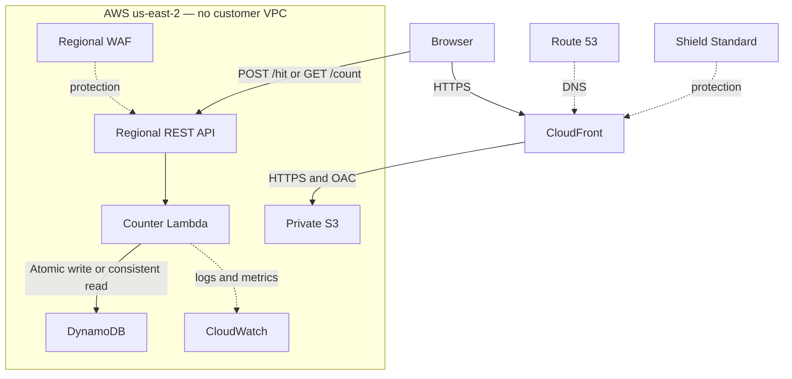

# HitCloud — website access counter

A Portuguese “Em breve” page served over HTTPS, with a shared atomic DynamoDB counter. Backend and infrastructure use Python 3.12; the frontend uses TypeScript and Vite. The active Kiro specification is `.kiro/specs/website-access-counter/`; `page-view-counter/` is historical.

## Local setup (no AWS account needed)

Use Python 3.12+, Node.js 22+ (tested with Node 24), npm, and Bash/WSL for `deploy.sh`.

```bash
python -m venv .venv
source .venv/bin/activate
# Windows PowerShell: .venv\Scripts\Activate.ps1
python -m pip install -r requirements.txt -r requirements-dev.txt
npm ci
npm --prefix frontend ci
python -m pytest -q
npm --prefix frontend test -- --run
npm --prefix frontend run build
npx cdk synth --quiet
npm --prefix frontend run dev
```

Open `http://localhost:5173/?oad=1` for a clearly labeled offline demonstration (42 is fictitious). Without mock mode, the page requires `/config.json` containing `{"apiUrl":"https://YOUR-API.execute-api.us-east-2.amazonaws.com/dev"}`. Copy `frontend/config.example.json` to `frontend/public/config.json` for local development against your test API. Configure that origin explicitly in `development_origins`. No AWS credentials belong in this file or the browser.

Each full page load attempts one POST /hit. “Atualizar contagem” only issues GET /count. Failures show a Portuguese error; failed increments are never automatically retried. GET returns zero for an absent counter. Concurrent updates use DynamoDB's atomic expression, not read-modify-write. This counts accepted access registrations, not unique people: bots, repeat visits and externally repeated POSTs can change the total. Blocked JavaScript, throttling and failed calls can undercount. Atomic writes are not exactly-once; ambiguous network failures remain possible. The write SDK uses `total_max_attempts=1` to disable retries.

## AWS prerequisites

Install AWS CLI v2. Authenticate using a named profile/SSO or the standard AWS credential chain. Do not commit keys. Your deployer needs permission to use the CDK bootstrap deployment roles and provision CloudFormation, IAM, S3, CloudFront, Lambda, API Gateway (including its regional CloudWatch account role), DynamoDB, WAF and CloudWatch. Custom domains additionally need ACM and Route 53 permissions. The runtime Lambda gets only table GetItem/UpdateItem and scoped logging permissions.

The account is resolved from your AWS credentials; there is no placeholder account in `cdk.json`. Set `aws_account` only if you intentionally want an explicit account. Review `cdk diff` and the deployment identity before deploying. CDK's API Gateway logging role configures the account-level regional setting: coordinate this with existing API Gateway deployments.

```bash
export AWS_PROFILE=YOUR_PROFILE
aws sts get-caller-identity
npx cdk bootstrap aws://YOUR_ACCOUNT_ID/us-east-2
./deploy.sh --dry-run
./deploy.sh
```

The default uses the CloudFront HTTPS hostname and does not create an ACM stack. `--dry-run` builds and synthesizes only. `deploy.sh` runs synthesis, diff, deployment, and `scripts/publish_frontend.py`. The publisher reads CloudFormation outputs, writes config.json, uploads hashed assets first, then configuration and HTML, and invalidates `/`, `/index.html`, and `/config.json`. Old hashed assets are deliberately retained for cached pages. S3 versioning also retains previous object versions; plan lifecycle cleanup appropriate to your rollback window.

Deployment commands create billable AWS resources. Nothing in the supplied verification results indicates a live AWS deployment.

## Custom domain (optional)

Use an existing public Route 53 hosted zone with working delegation. For `counter.example.com` hosted in `example.com`, set all three values in `cdk.json` context:

```json
{
  "domain_name": "counter.example.com",
  "hosted_zone_id": "YOUR_HOSTED_ZONE_ID",
  "hosted_zone_name": "example.com"
}
```

Bootstrap `us-east-1` in the same account as well. Then `./deploy.sh` automatically deploys CertStack in us-east-1, reads its certificate ARN, and passes the ARN into AppStack in us-east-2. The regional stack creates Route 53 A/AAAA aliases to CloudFront. DNS validation may take time.

Manual equivalent:

```bash
npx cdk bootstrap aws://YOUR_ACCOUNT_ID/us-east-1
npx cdk deploy CertStack -c certificate_only=true --outputs-file cert-outputs.json
# Read CertificateArn from cert-outputs.json and use it below:
npx cdk synth AppStack -c certificate_arn=YOUR_CERTIFICATE_ARN
npx cdk diff AppStack -c certificate_arn=YOUR_CERTIFICATE_ARN
npx cdk deploy AppStack -c certificate_arn=YOUR_CERTIFICATE_ARN --outputs-file cdk-outputs.json
python scripts/publish_frontend.py
```

CloudFormation regional exports cannot bridge us-east-1 and us-east-2. This explicit two-phase ARN handoff avoids that restriction. The custom-domain dry run always checks CertStack; to also synthesize AppStack, supply the issued certificate ARN. Outputs include WebsiteUrl, ApiUrl, DistributionId, TableName, BucketName, and Environment.

## Configuration and security

Set `environment` to `production` to retain the DynamoDB table and enable deletion protection. Defaults use a `dev` stage. Configure API rate/burst limits, WAF per-IP rate limit, alarm thresholds and log retention in `cdk.json`. Optional `development_origins` is a JSON array, empty by default. Lambda selects a single allowed CORS origin, including on preflight. Gateway-generated errors expose the primary website origin only; local development may see a generic network error for gateway-level rejection. CORS is browser-enforced, not authentication. This is an intentionally public API.

Private S3 uses OAC with always-signed requests. CloudFront redirects HTTP to HTTPS and sets security headers, including CSP restricted to the API origin. Only content-hashed `assets/*` receive long caching; HTML revalidates and config.json is served with no-store. The API also returns no-store. No VPC, NAT gateway, EC2 or load balancer is required. Regional managed services provide their own availability; they are not placed in customer subnets. Shield Standard applies automatically to eligible resources; Shield Advanced is not provisioned.

WAF uses AWSManagedRulesCommonRuleSet and an IP rate rule. These are abuse controls, not a guarantee of human-only traffic. Shared NAT addresses can cause false positives. Check WAF metrics and sampled requests when investigating blocks. Full WAF logging is not enabled by this project; enable and redact it deliberately if needed, and review its cost/privacy implications. Backend application logs contain status only; API Gateway execution logging is ERROR with data tracing disabled.

## Monitoring and capacity

Five alarms cover Lambda errors, Lambda throttles, API 5xx, DynamoDB GetItem/UpdateItem system errors, and UpdateItem throttling. Missing data is non-breaching. Alarms do not notify anyone by default. To add notifications, create/import an SNS topic, subscribe and confirm the intended recipients, then attach `alarm.add_alarm_action(aws_cloudwatch_actions.SnsAction(topic))` in the stack.

On-demand billing does not remove per-item/partition throughput limits. A single counter is a hot key. Sustained high write rates may require sharded counters and an aggregation/read strategy, which is outside this version. API quotas, Lambda concurrency and WAF thresholds also constrain throughput.

Main cost drivers: WAF's fixed Web ACL/rule and request charges, API Gateway requests, CloudFront requests/data transfer, Lambda invocations/duration, DynamoDB reads/writes/PITR, S3 storage/versions/requests, and CloudWatch logs/alarms. Route 53 hosted zones and DNS queries add costs for custom domains. Use AWS Budgets and current regional pricing; no price estimate is hardcoded here.

## Optional live integration test

Use an isolated dev/test deployment with no other traffic. The test resolves the actual API from CloudFormation outputs and checks both deployed Environment tags and outputs. It skips production, unknown environments, and runs without explicit opt-in. It performs up to 20 real increments and does not undo them.

```bash
INTEGRATION_TEST=true INTEGRATION_STACK_NAME=AppStack INTEGRATION_HITS=5 \
  python -m pytest tests/test_integration.py -q
```

Do not use this as a production load test. A concurrent third-party request or ambiguous failure can invalidate the exact-delta assertion.

## Cleanup

For default deployments: `npx cdk destroy AppStack`. For custom-domain stacks, pass `-c certificate_arn=YOUR_CERTIFICATE_ARN`; destroy AppStack before CertStack (`npx cdk destroy CertStack -c certificate_only=true`). Confirm the target account and environment first.

The website bucket is retained in every environment, including all object versions. In production the DynamoDB table is also retained with deletion protection. Retained resources continue to incur charges; delete them separately only after deciding their data is no longer needed. To delete a retained table, disable deletion protection explicitly. To delete a versioned bucket, remove all versions and delete markers. The existing hosted zone is imported and is not deleted.

## Architecture



See `VERIFICATION.md` for the checks performed on this completed version.

## Region correction (2026-10-09)

The application, publishing script, integration test target and examples now use us-east-2 (Ohio). CloudFront's optional ACM certificate remains in us-east-1. Update the local profile using `aws configure set region us-east-2 --profile hitcloud`. Changing the default region does not move or delete resources in us-west-2; any earlier CDKToolkit DELETE_FAILED cleanup must still target us-west-2. Update any region-scoped IAM resource ARNs and KMS ViaService conditions accordingly. Bootstrap us-east-2 separately, passing the intended custom CloudFormation execution policy.
